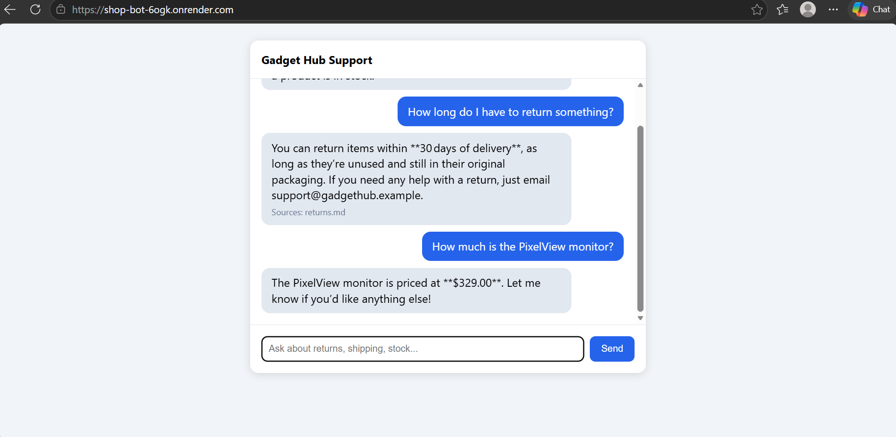

# Gadget Hub Support Bot

An AI customer-support chatbot for a fictional online electronics shop, built with **Retrieval-Augmented Generation (RAG)** and **tool use**. It answers from the shop's own documents and looks up live prices and stock, instead of guessing.

**Live demo:** https://shop-bot-6ogk.onrender.com
*(Hosted on a free plan, so it sleeps when idle. The first load can take about a minute.)*



## What it does
- Answers questions about returns, shipping, warranty, and payments using only the shop's documents
- Checks live price and stock through function calling (`get_stock`)
- Says "I don't know" and points to the support email when the answer isn't in the data
- Shows which source documents each answer came from

## How it works
```
Question -> Retrieve -> Augment -> Generate -> Answer + sources
              |            |           |
        TF-IDF search   prompt with   LLM, which can call
        over document   retrieved     get_stock for live
        chunks          context       price and stock
```
1. **Retrieve:** the documents in `knowledge/` are split into sections, and TF-IDF finds the ones closest to the question.
2. **Augment:** those sections go into the prompt as the only allowed source of truth.
3. **Generate:** the model answers, and can call `get_stock` for live data from `data/products.json`.

## Tech stack
Python, Flask, scikit-learn (TF-IDF), an OpenAI-compatible LLM API (Groq by default), vanilla JavaScript front end, Gunicorn, Render.

## Design decisions
- **Provider-agnostic:** the API key, base URL, and model are environment variables, so switching between Groq, Gemini, OpenAI, or a local Ollama model needs no code changes.
- **Grounded answers:** the system prompt restricts the model to the retrieved context and the stock tool.
- **Abuse protection:** per-visitor and daily request limits protect the free API quota on a public demo.
- **Secrets stay out of code:** the API key lives only in environment variables.

## Limitations and roadmap
- TF-IDF matches keywords, not meaning, so "when do you open?" can miss a document that says "support hours". Next step: embeddings with a vector database (Chroma).
- Planned: a test set to measure answer quality, streaming replies, MySQL-backed products, and handoff to a human agent.

## Run locally
```
python -m venv venv
venv\Scripts\activate
pip install -r requirements.txt
$env:LLM_API_KEY="your-key"
python app.py
```
Then open http://127.0.0.1:5000. Without a key, the app runs in demo mode and shows the retrieved text only.

## Project structure
```
app.py            Flask API, prompt building, tool-use loop, rate limiting
rag.py            Document chunking and TF-IDF retriever
knowledge/        Shop documents (returns, shipping, FAQ)
data/             Product catalog with prices and stock
static/           Chat interface
```

## Author
Anik Dey, BSc Software Engineering with Multimedia | [GitHub](https://github.com/deyanik1103-cloud)